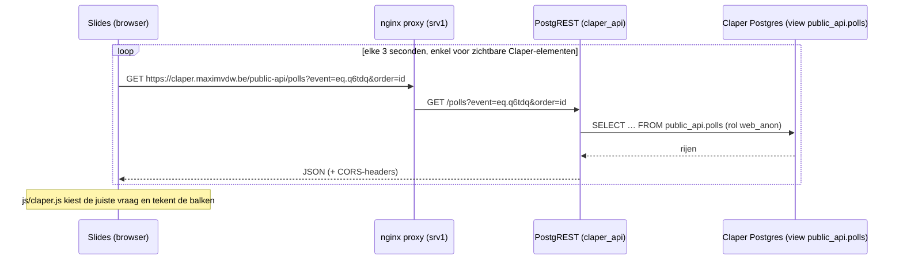

# Kennisdeling - Maxim Van de Wynckel

> Deze repo bevat alle persoonlijke presentaties van Maxim Van de Wynckel binnen het team ApoCow. Deze repo wordt persoonlijk gebruikt maar wordt ook gelinked vanaf https://www.milieuinfo.be/confluence/display/AEO/TAC+-+Kennisdeling

Reveal.js presentaties met Nunjucks templates en Eleventy static site generator in Vlaamse overheid huisstijl.

## Installatie

```bash
npm install
```

## Gebruik

### Ontwikkelen

Start de development server met hot reload:

```bash
npm start
```

Presentaties zijn beschikbaar op http://localhost:8080

### Nieuwe presentatie aanmaken

Maak een nieuwe directory met hiërarchische structuur (bijv. `jaar/topic/`) en voeg een bestand toe:

#### Optie 1: Markdown (`.md`)

Voor eenvoudige presentaties met Markdown syntax:

```markdown
---
layout: presentation.njk
title: Mijn Presentatie Titel
subtitle: Optionele ondertitel
presentationDate: 4 februari 2026
---

## Eerste Slide

Inhoud in **Markdown**!

- Lijsten
- *Italic* en **bold**
- `Code`

---

## Tweede Slide

```javascript
const code = "werkt ook";
```

---

## Mermaid Diagram

<div class="mermaid">
graph LR
    A[Start] --> B[Einde]
</div>
```

**Note:** Slides scheiden met `---`. HTML kan gebruikt worden voor custom elementen.

#### Optie 2: Nunjucks (`.njk`)

Voor complexere presentaties met volledige HTML controle:

```nunjucks
---
layout: presentation.njk
title: Mijn Presentatie Titel
subtitle: Optionele ondertitel
presentationDate: 4 februari 2026
---

<section>
  <h2>Eerste Slide</h2>
  <p>Inhoud hier...</p>
</section>

<section>
  <h2>Tweede Slide</h2>
  <ul>
    <li>Punt 1</li>
    <li>Punt 2</li>
  </ul>
</section>

<section>
  <h2>Mermaid Diagram</h2>
  <div class="mermaid">
graph TD
    A[Start] --> B{Beslissing}
    B -->|Ja| C[Actie 1]
    B -->|Nee| D[Actie 2]
  </div>
</section>
```

### Mermaid Diagrammen

Mermaid wordt automatisch ondersteund. Gebruik `<div class="mermaid">` voor diagrammen:

**Flowchart:**
```html
<div class="mermaid">
graph TD
    A[Start] --> B[Einde]
</div>
```

**Sequence Diagram:**
```html
<div class="mermaid">
sequenceDiagram
    Client->>Server: Request
    Server-->>Client: Response
</div>
```

**Andere types:** Class diagrams, State diagrams, ER diagrams, Gantt charts, etc.

### Live vragen met Claper

Het publiek kan live antwoorden via [Claper](https://claper.maximvdw.be). De vragen beheer je in
Claper zelf (`https://claper.maximvdw.be/e/<code>/manage`); de slides tonen alleen een QR-code
en de resultaten, in de huisstijl van de presentatie.

**Gebruik in een `.njk` presentatie:**

```njk
{# Grote QR-code + de vraag die op dit moment in Claper openstaat #}


{# Idem, en opent met presenter-token vraag 1 in Claper #}


{# Resultaten van één vraag (poll-id uit Claper), met een kleine QR-code #}



{# Resultaten van vraag 2 van quiz 1; het juiste antwoord verschijnt na één klik #}


{# Muur met de berichten die je in Claper hebt vastgepind #}

```

- `claperSlide` toont altijd de vraag die in Claper **open** staat. Open je in Claper een andere
  vraag, dan wisselt de slide mee.
- Op de **eerstvolgende section** na een `claperSlide` (inclusief haar verticale slides) staat
  rechtsonder een kleine versie: de open vraag + QR-code. Zo kan je verder presenteren terwijl
  mensen antwoorden. Klik erop om ze te vergroten.
- `claperPoll` toont één vaste vraag. Zonder titel neemt de slide de vraag uit Claper over.
- Het poll-id van een vraag vind je via de API (zie hieronder) in het veld `id`.
- `claperQuiz` toont de resultaten van één vraag van een **quiz** (vraagnummer vanaf 1). Een
  Claper-quiz verloopt in eigen tempo: deelnemers beantwoorden alle vragen na elkaar en zien
  daarna hun score. De slide toont eerst de verdeling; de volgende stap (pijltje) markeert het
  juiste antwoord in het groen.
- `claperWall` toont de **berichten** die je in `/manage` vastpint (maximaal 9, nieuwste eerst),
  zonder naam. Niet-vastgepinde berichten verschijnen nooit op de slides.

#### Hoe de slides met de API communiceren

De slides praten **niet** met Claper zelf (dat vraagt een login), maar met een aparte, publieke
en read-only API die alleen geaggregeerde resultaten bevat:



1. **Build (Eleventy).** De shortcodes in `.eleventy.js` genereren de HTML van de slide: de
   QR-code als inline SVG (pakket `qrcode`, dus ook zichtbaar in PDF-exports) en een lege
   `.claper-results` container. De slide krijgt drie data-attributen:

   | Attribuut | Betekenis |
   |---|---|
   | `data-claper-event` | event-code, bv. `q6tdq` |
   | `data-claper-poll` | poll-id, of `active` voor de vraag die openstaat |
   | `data-claper-api` | basis-URL van de API: `https://claper.maximvdw.be/public-api` |

   Een `claperSlide` heeft daarnaast `data-claper-live`: dat markeert de slide waarna de
   hoekwidget verschijnt.

2. **Ophalen (`js/claper.js`).** Bij elke slidewissel en daarna elke 3 seconden
   (`REFRESH_MS`) doet het script één `fetch` per event:

   ```
   GET https://claper.maximvdw.be/public-api/polls?event=eq.q6tdq&order=id
   ```

   Er wordt alleen gevraagd zolang een Claper-slide of de hoekwidget zichtbaar is én het
   browsertabblad actief is. Slide en hoekwidget delen dezelfde request. De syntax
   `event=eq.q6tdq` is die van [PostgREST](https://docs.postgrest.org/en/stable/references/api/tables_views.html#horizontal-filtering).

3. **Antwoord.** Een JSON-array met één object per vraag (alleen vragen waarvoor in Claper
   "resultaten tonen" aanstaat):

   ```json
   [
     {
       "event": "q6tdq",
       "id": 1,
       "title": "Welke dataformaten gebruik je vandaag om gegevens uit te wisselen?",
       "position": 0,
       "active": true,
       "multiple": true,
       "total": 61,
       "options": [
         { "id": 1, "label": "CSV / Excel", "votes": 24 },
         { "id": 2, "label": "JSON", "votes": 17 }
       ],
       "updated_at": "2026-10-12T09:20:00"
     }
   ]
   ```

   `active` is de vraag die in Claper openstaat; `total` is de som van alle stemmen (bij
   `multiple` kan één persoon meerdere opties kiezen, dus percentages zijn ten opzichte van het
   totaal aantal stemmen, niet van het aantal deelnemers).

4. **Tekenen.** Het script zoekt de vraag (`active` of het id) en zet de balken, percentages en
   aantallen in `.claper-results`. Labels worden ge-escaped. Lukt een request niet, dan blijft het
   laatste resultaat staan; is er nog niets geladen, dan verschijnt "Resultaten niet
   beschikbaar". De opmaak staat in `css/claper.css`.

#### Vragen automatisch openen vanuit de slides

Zodat je niet tussen de slides en Claper hoeft te wisselen, kunnen de slides zelf de juiste vraag
in Claper openen — de gsm's van het publiek wisselen dan mee.

1. Open de presentatie **één keer** met de presenter-token:
   `https://maximvdw.github.io/presentaties-vo/2026/vc-event/?claper-token=<token>`
   De token verdwijnt meteen uit de adresbalk, maar blijft op die computer bewaard
   (`localStorage`: alle tabbladen, ook na een herstart van de browser). Bij het laden verschijnt
   kort "Claper: presentermodus actief". Vergeten doe je met `?claper-token=uit`. Zonder token doen de slides niets: wie de publieke slides bekijkt, kan
   niets openen.
   Bij het openen wordt ook het Claper-event **gestart** als de startdatum nog in de toekomst
   ligt (anders zien deelnemers een aftelling) — handig voor een dry run.
2. Elke `claperPoll`-slide opent dan haar vraag zodra ze getoond wordt. Op een gewone section
   kan dat ook:

   ```html
   <section data-claper-activate="2"> … </section>
   ```

   Op een section met verticale slides geldt het voor al die slides. Je krijgt bovenaan kort een
   melding ("Claper: vraag 2 geopend"), of een rode melding als het mislukt.
   Een quiz of formulier open je met `data-claper-activate="quiz:1"` of `"form:1"`.
3. Met de token toont een slide met `data-claper-reactions="clap"` de **reacties** die
   deelnemers sturen terwijl die slide openstaat: ze borrelen rechts op het scherm op. Je kiest
   welke types (`heart`, `clap`, `hundred`, `raisehand`, gescheiden door komma's); andere slides
   tonen geen reacties. Claper bewaart die niet; de control-service telt ze live
   (`POST /control/reactions` met `{"event": "q6tdq"}` en token) en de slides tonen elke nieuwe reactie.
   Lukt dat niet, dan verschijnt bovenaan een rode melding. Meestal staat de origin van de pagina
   dan niet in `CLAPER_CONTROL_ORIGINS` (nu: github.io, `localhost:8080`, `localhost:8083` en
   `192.168.1.6:8083`). In een tab op de achtergrond wacht het deck en toont het de reacties zodra
   je terugkeert.
   `claperQuiz`- en `claperWall`-slides openen zelf niets.

Technisch: `js/claper.js` stuurt

```
POST https://claper.maximvdw.be/control/activate
Authorization: Bearer <token>
Content-Type: application/json

{"event": "q6tdq", "poll": 2}
```

(of `{"event": "q6tdq", "quiz": 1}` / `{"event": "q6tdq", "form": 1}`) naar de control-service
naast Claper (bij het openen eerst `POST …/control/start` met
`{"event": "q6tdq"}`). Die controleert de token, controleert dat de vraag bij
dat event hoort, en doet dan in Claper hetzelfde als de "activeer"-knop in `/manage`. Dezelfde
vraag wordt niet twee keer na elkaar verstuurd; de preview-kaders van de speaker view (`S`) en een
PDF-export sturen niets. Er is ook `POST /control/deactivate` met dezelfde body.

#### Vragen beheren vanuit de repo

De polls, quizzen en formulieren van een presentatie staan in een JSON-bestand naast de slides, bv.
`2026/vc-event/claper-polls.json`:

```json
{
  "event": "q6tdq",
  "polls": [
    { "id": 5, "title": "Een gemeente voert een zone 30 in aan een schoolpoort. Wat is dit?",
      "options": ["Een observatie", "Een actuatie", "Geen van beide"] },
    { "title": "Een nieuwe vraag", "options": ["Ja", "Nee"], "multiple": false }
  ],
  "quizzes": [
    { "title": "Test jezelf",
      "questions": [
        { "title": "Wat is dit?", "options": ["Een observatie", "Een actuatie"], "correct": [1] }
      ] }
  ],
  "forms": [
    { "title": "Wat neem je mee?",
      "fields": [{ "name": "Wat neem je mee?", "type": "text", "required": true }] }
  ]
}
```

```bash
npm run claper:sync -- 2026/vc-event/claper-polls.json
```

- Met een `id` wordt die vraag **aangepast**, zodat de id's in `claperPoll` en
  `data-claper-activate` blijven kloppen. Zonder `id` wordt op titel gezocht, of de vraag wordt
  **aangemaakt** (dicht, resultaten zichtbaar). Het script toont het nieuwe id: zet het in het
  JSON-bestand en in de slides.
- Opties worden op volgorde gekoppeld: een optie hernoemen behoudt haar stemmen. Een optie
  verwijderen die al stemmen heeft, wordt geweigerd.
- De token komt uit `.env` in de root van de repo (`CLAPER_CONTROL_TOKEN=…`, niet gecommit).
- Quizzen en formulieren werken op dezelfde manier (`id` of titel). `correct` bevat de
  posities (vanaf 0) van de juiste antwoorden. Een quiz staat open voor anonieme deelnemers.
  Een quiz die al antwoorden heeft, wordt niet meer aangepast ("behouden").
- Wat uit het bestand verdwijnt, blijft in Claper bestaan; verwijderen doe je in `/manage`.

Het script doet `POST https://claper.maximvdw.be/control/sync` met de inhoud van het bestand.
De token kan dus ook **vragen, quizzen en formulieren aanmaken en aanpassen** (niet verwijderen,
geen stemmen wissen): deel hem niet.

**Wat de API wel en niet prijsgeeft.** Alleen wat drie views tonen: `public_api.polls` (vraag,
opties, aantallen, welke vraag openstaat), `public_api.quiz_questions` (idem per quizvraag, met
het juiste antwoord) en `public_api.messages` (enkel **vastgepinde** berichten: tekst en aantal
reacties). Geen gebruikers, deelnemers, namen, niet-vastgepinde berichten of wie wat stemde — de
anonieme databaserol mag enkel die views lezen. Iedereen die de event-code kent,
kan de resultaten opvragen; dat is de bedoeling (de code staat ook in de QR-code).

**Lokaal testen.** `npm start` werkt gewoon: de API stuurt CORS-headers, dus
`http://localhost:8080` mag ze ophalen. Zonder netwerk tonen de slides "Resultaten niet
beschikbaar".

**PDF-export.** De hoekwidget wordt verborgen en resultaten worden niet in de PDF opgenomen;
de QR-codes wel.

**Serverkant.** De API (PostgREST-service `claper_api`), de view en de proxyroute
`/public-api/` zijn beschreven in de serverdocumentatie (`docker-stacks.md` § claper;
`containers/claper/public_api.sql`).

### Default configuratie

De volgende waarden worden automatisch ingevuld vanuit `_data/defaults.json`:
- **author**: Maxim Van de Wynckel
- **organization**: Departement Omgeving
- **theme**: vlaanderen
- **logo-icoon**: automatisch `vl-vi-vlaanderen` linksonder op elke slide

Je kan deze overschrijven in de frontmatter van je presentatie.

### Themes

#### Vlaanderen (standaard)

Standaard Vlaamse overheid huisstijl met geel en blauw.

```yaml
theme: vlaanderen
```

#### Omgeving

Departement Omgeving branding met groene accent kleur (#447a6d).

```yaml
theme: omgeving
```

Pas de volgende frontmatter velden aan:
```yaml
theme: omgeving
organization: Departement Omgeving
```

### Bouwen

Bouw de statische site:

```bash
npm run build
```

### Exporteren naar PDF

In een nieuwe terminal: `npm run export`

PDF bestanden worden opgeslagen in de `output/` directory.

## Reveal.js Features

- Navigatie met pijltjestoetsen of swipe gestures
- Overview mode: druk op `ESC` of `O`
- Speaker notes: druk op `S`
- Fullscreen: druk op `F`
- Zoeken: druk op `CTRL+SHIFT+F`
- Print naar PDF: voeg `?print-pdf` toe aan de URL
- Lineare weergave (voor pointers): voeg `?presenter` toe aan de URL

## Licentie

MIT
